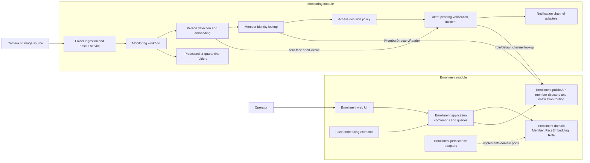
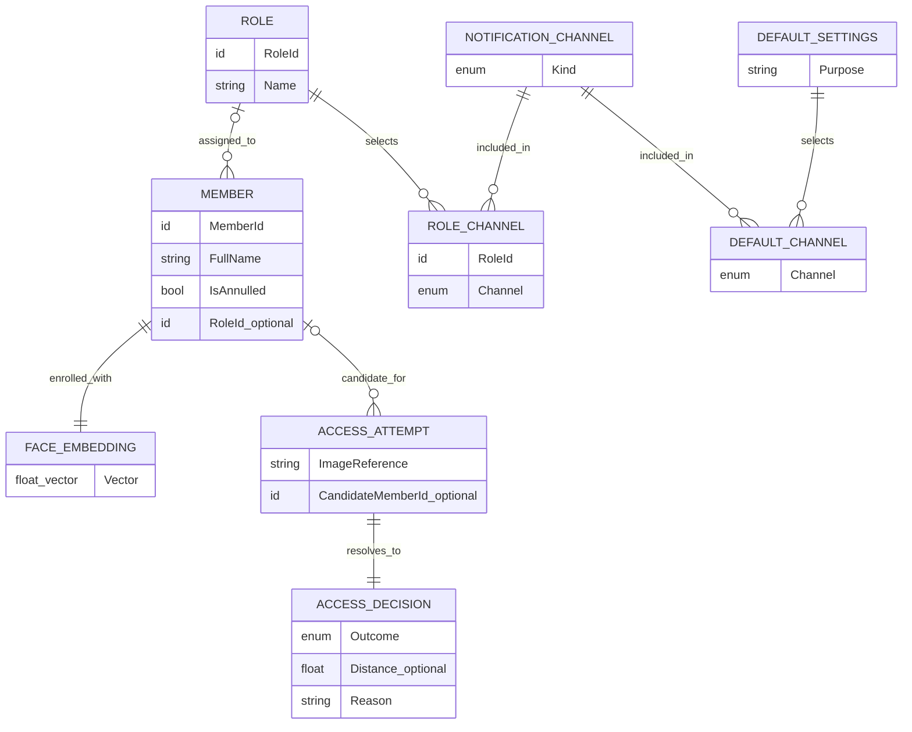
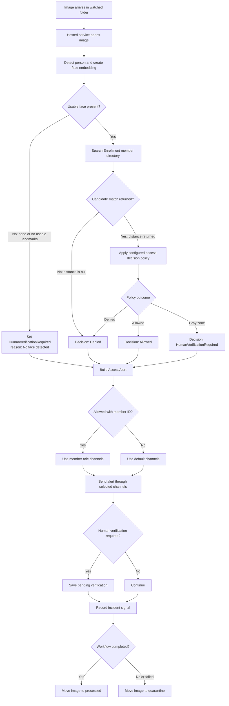

# CamGuard: architecture and monitoring workflow

This training diagram shows how member enrollment supports camera monitoring, how an image moves through the access decision, and where notifications and images go. The relationship view is conceptual; it is not a database schema.

## 1. Component map

**How to read it:** Enrollment creates the member and reference embedding used by later recognition. Monitoring owns the incoming-image loop and decision workflow. It asks Enrollment through the public API for the closest enrolled member; it does not reach into Enrollment's infrastructure implementation.

## 2. Conceptual relationship map

`ACCESS_ATTEMPT`, `ACCESS_DECISION`, and the channel link records are teaching concepts for the relationships in the flow. This diagram does not assert that each one is a persisted table. A member may have no role; in that case notification routing uses the default channels.

## 3. One image through the workflow

### Decision notes

- **No usable face:** detection sets a terminal human-verification decision. The graph goes directly to notification and skips identity lookup and the access policy.
- **No member match:** a missing distance means no enrolled member matched; the decision is denied without calling the distance policy.
- **Matched member:** the configured policy maps the returned distance to Allowed, Denied, or HumanVerificationRequired. The actual numeric thresholds come from configuration and are intentionally not duplicated here.
- **Notification routing:** only an Allowed alert with a member ID uses that member's role channels. Other outcomes use default channels. If a member-channel lookup fails, routing falls back to defaults; if that lookup also fails, the service tries every configured channel. One channel failure does not prevent the others.
- **File handling:** a completed workflow moves the image to processed. A false result or an unhandled workflow error moves it to quarantine. Thrown workflow errors are retried up to three times with a fresh image stream; a successful run returning false is quarantined without retry.
- **Failure isolation:** notification and incident-sink failures are logged and do not fail the workflow run. Human-verification outcomes are saved as pending verifications.

## Source anchors

- Monitoring graph and its short-circuit edge: `src/Monitoring.Application/MonitoringWorkflowHost.cs`
- Detection and zero-face decision: `src/Monitoring.Application/DetectPersonExecutor.cs`
- Identity match: `src/Monitoring.Application/VerifyIdentityExecutor.cs`
- Null-distance behavior: `src/Monitoring.Application/DecideAccessExecutor.cs`
- Alert, pending verification, and incident signal: `src/Monitoring.Application/NotifyExecutor.cs`
- Watch, retries, and archive/quarantine: `src/Monitoring.Infrastructure/MonitoringHostedService.cs`
- Member/role/default channel routing: `src/Monitoring.Infrastructure/CompositeNotificationService.cs`, `src/Enrollment.PublicApi/NotificationRoutingReader.cs`
- Member, role, and enrollment concepts: `src/Enrollment.Domain/Member.cs`, `src/Enrollment.Domain/Role.cs`, `src/Enrollment.Domain/FaceEmbedding.cs`

Open this file in a Mermaid-enabled Markdown viewer to render the diagrams.
