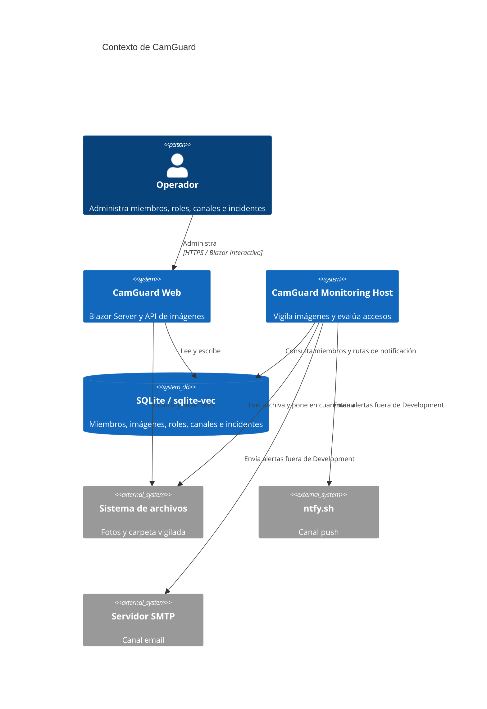
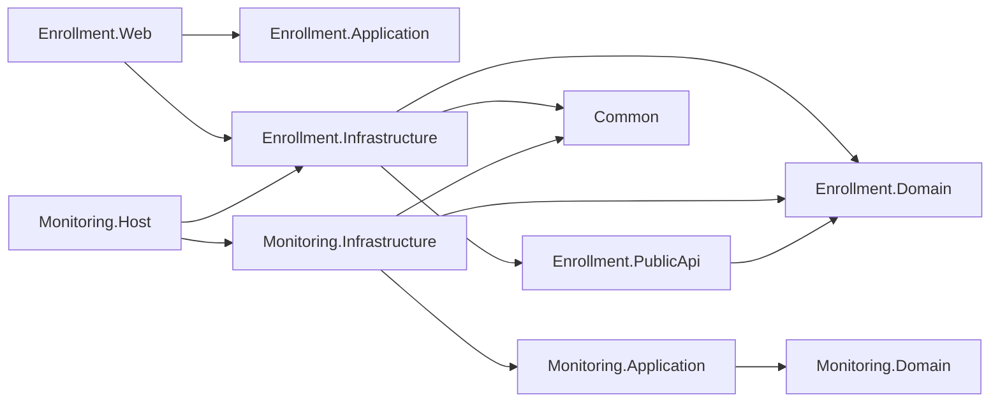
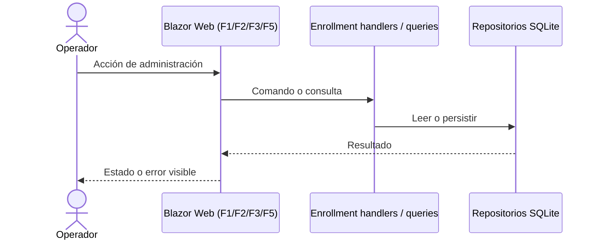
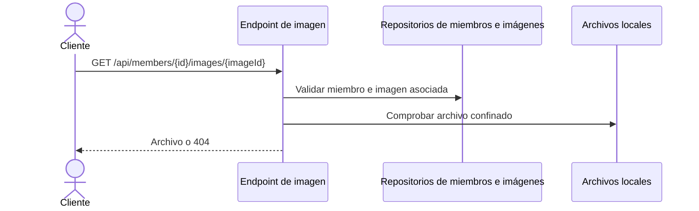
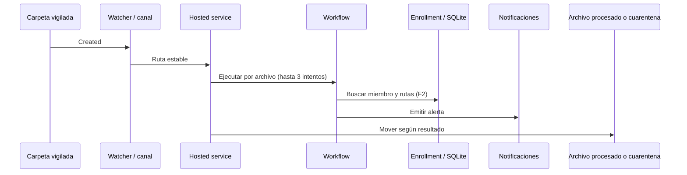

# Arquitectura

## 1. Contexto

CamGuard reúne dos procesos .NET: una aplicación web Blazor Server para administrar miembros, roles, canales de notificación e incidentes (F1–F3, F5), y un host de monitoreo que ingiere imágenes desde una carpeta y ejecuta detección, identificación, decisión de acceso y notificación (F4; depende de F2). La web usa SQLite/sqlite-vec y archivos locales; el host usa esos mismos adaptadores de Enrollment, la carpeta vigilada, ntfy.sh y SMTP. [src/Enrollment.Web/Program.cs:5-13,28-35](../src/Enrollment.Web/Program.cs) [src/Monitoring.Host/Program.cs:8-13](../src/Monitoring.Host/Program.cs) [src/Monitoring.Infrastructure/MonitoringServiceCollectionExtensions.cs:73-110](../src/Monitoring.Infrastructure/MonitoringServiceCollectionExtensions.cs)

## 2. Estructura de la solución

`Enrollment.Domain` y `Monitoring.Domain` contienen modelos/reglas; sus capas Application definen flujos y puertos; Infrastructure implementa persistencia, archivos, modelos faciales, hospedaje y canales externos. `Enrollment.PublicApi` expone puertos de lectura consumidos por Monitoring sin referenciar su infraestructura. `Common` comparte opciones/observabilidad. `Enrollment.Web` es la UI/API; `Monitoring.Host` compone el proceso de fondo. `Enrollment.Console` es otro ejecutable presente en la solución, pero no es el host configurado por `Monitoring.Host`. [src/Enrollment.Web/Enrollment.Web.csproj:8-10](../src/Enrollment.Web/Enrollment.Web.csproj) [src/Enrollment.Infrastructure/Enrollment.Infrastructure.csproj:3-8](../src/Enrollment.Infrastructure/Enrollment.Infrastructure.csproj) [src/Monitoring.Infrastructure/Monitoring.Infrastructure.csproj:3-7](../src/Monitoring.Infrastructure/Monitoring.Infrastructure.csproj) [src/Monitoring.Host/Monitoring.Host.csproj:7-18](../src/Monitoring.Host/Monitoring.Host.csproj)

## 3. Librerías

Versiones centralizadas en [Directory.Packages.props](../Directory.Packages.props); no se repiten versiones en cada proyecto.

| Paquete directo | Versión | Uso |
|---|---:|---|
| FaceAiSharp / FaceAiSharp.Bundle | 0.6.35 | Detección facial y embeddings |
| Microsoft.ML.OnnxRuntime | 1.26.0 | Runtime nativo ONNX CPU |
| CommunityToolkit.VectorData.SqliteVec | 1.0.1-preview | Almacenamiento/búsqueda vectorial SQLite |
| Microsoft.Data.Sqlite | 10.0.12 | SQLite |
| Microsoft.Agents.AI.Workflows | 1.0.0-preview.260108.1 | Grafo de procesamiento de imágenes |
| MailKit | 4.16.0 | Entrega SMTP |
| CSharpFunctionalExtensions | 3.7.0 | Resultados tipados en Enrollment |
| Microsoft.Extensions.* | 10.0.12 (según paquete) | Host, DI, options, configuración, logging y HTTP |

ntfy usa `HttpClient` y no agrega un paquete dedicado; xUnit, Moq.AutoMock y Microsoft.NET.Test.Sdk son dependencias de pruebas. [Directory.Packages.props:7-50](../Directory.Packages.props)

## 4. Composición (DI)

`Enrollment.Web` registra componentes Razor interactivos y llama `AddEnrollment`; `Monitoring.Host` llama `AddEnrollment` y `AddMonitoring` antes de ejecutar el host. [src/Enrollment.Web/Program.cs:5-14](../src/Enrollment.Web/Program.cs) [src/Monitoring.Host/Program.cs:8-13](../src/Monitoring.Host/Program.cs)

`AddEnrollment` enlaza `VectorStoreOptions`; registra detector y generador FaceAiSharp como singleton, repositorios/adaptadores y handlers como scoped, y fuentes nombradas de observabilidad. [src/Enrollment.Infrastructure/EnrollmentServiceCollectionExtensions.cs:30-80](../src/Enrollment.Infrastructure/EnrollmentServiceCollectionExtensions.cs)

`AddMonitoring` enlaza `AccessDecisionOptions`, `WatchFolderOptions` y opciones de canales; valida umbrales; registra detector, ingestión y repositorio de verificaciones pendientes como singleton, ejecutores y workflow como scoped, y el `MonitoringHostedService` como hosted service. La notificación es logging en Development y compuesta por ntfy/email en otros entornos; el workflow scoped se resuelve en un scope por archivo. [src/Monitoring.Infrastructure/MonitoringServiceCollectionExtensions.cs:30-132](../src/Monitoring.Infrastructure/MonitoringServiceCollectionExtensions.cs) [src/Monitoring.Infrastructure/MonitoringHostedService.cs:34-43](../src/Monitoring.Infrastructure/MonitoringHostedService.cs)

## 5. Flujos

### Web interactiva — F1, F2, F3 y F5

Las páginas Blazor resuelven repositorios/handlers y presentan sus resultados al operador. El pipeline configura antiforgery, HTTPS, assets y rutas Razor. La entrada web sirve imágenes mediante endpoint dedicado. [src/Enrollment.Web/Program.cs:16-35](../src/Enrollment.Web/Program.cs)

### GET de imagen de miembro — F1

`GET /api/members/{id}/images/{imageId}` valida ids, confirma miembro y registro de imagen, confina la ruta al directorio del miembro y devuelve 404 si falta algún elemento; si existe, transmite el archivo. [src/Enrollment.Web/MemberImageEndpoints.cs:18-69](../src/Enrollment.Web/MemberImageEndpoints.cs)

### Job de carpeta vigilada — F4 (usa F2)

El watcher encola eventos en canal acotado, comprueba estabilidad y entrega archivos; el servicio hospedado corre el workflow (detectar → verificar identidad → decidir → notificar), reintenta hasta tres veces y archiva como procesado o pone en cuarentena. [src/Monitoring.Infrastructure/FileSystemWatchIngestionSource.cs:45-76,89-139](../src/Monitoring.Infrastructure/FileSystemWatchIngestionSource.cs) [src/Monitoring.Infrastructure/MonitoringHostedService.cs:26-69,79-107](../src/Monitoring.Infrastructure/MonitoringHostedService.cs) [src/Monitoring.Application/MonitoringWorkflowHost.cs:27-38](../src/Monitoring.Application/MonitoringWorkflowHost.cs)

## 6. Transacciones

Los repositorios de Enrollment usan SQLite/sqlite-vec; el repositorio de verificaciones pendientes de Monitoring es in-memory singleton y pierde sus datos al reiniciar. [src/Enrollment.Infrastructure/SqliteVecMemberRepository.cs:20-57](../src/Enrollment.Infrastructure/SqliteVecMemberRepository.cs) [src/Monitoring.Infrastructure/InMemoryPendingVerificationRepository.cs:7-25](../src/Monitoring.Infrastructure/InMemoryPendingVerificationRepository.cs)

No se observa una transacción única que abarque SQLite, archivos locales y notificaciones: el archivado ocurre después del workflow y usa el sistema de archivos por separado. Estas operaciones no son atómicas entre almacenes (**inferido del código**); se registra fragmento para confirmar la recuperación esperada. [src/Monitoring.Infrastructure/MonitoringHostedService.cs:43-68](../src/Monitoring.Infrastructure/MonitoringHostedService.cs) [src/Monitoring.Infrastructure/FileSystemImageArchiver.cs:25-42](../src/Monitoring.Infrastructure/FileSystemImageArchiver.cs)

## 7. Manejo de errores

En producción, excepciones web se redirigen a `/Error`; status codes se reescriben a `/not-found`. La ruta de error muestra Request ID. [src/Enrollment.Web/Program.cs:17-26](../src/Enrollment.Web/Program.cs) [src/Enrollment.Web/Components/Pages/Error.razor:6-14,27-35](../src/Enrollment.Web/Components/Pages/Error.razor)

El watcher registra overflow/eventos fallidos y omite archivos inestables tras reintentos. Monitoring reintenta el workflow tres veces; ante error final registra y mueve a cuarentena, y si la cuarentena falla lo registra sin propagarlo al bucle. Cancelación no se captura como error ordinario. [src/Monitoring.Infrastructure/FileSystemWatchIngestionSource.cs:96-107,114-139](../src/Monitoring.Infrastructure/FileSystemWatchIngestionSource.cs) [src/Monitoring.Infrastructure/MonitoringHostedService.cs:51-68,96-104](../src/Monitoring.Infrastructure/MonitoringHostedService.cs)

## 8. Logging / observabilidad

Los hosts usan logging de `Microsoft.Extensions.Logging`; niveles por defecto están configurados en `appsettings.json`. El código registra eventos de watcher, reintentos, cuarentena y alertas. `Common` crea `ActivitySource` y `Meter` con keyed singletons por módulo, y componentes instrumentados generan spans/tags. No se encontró registro de un exporter/provider de OpenTelemetry en estos composition roots; por tanto, los sinks/exportación, métricas exportadas y correlación distribuida no quedan configurados aquí. [src/Common/ObservabilityServiceCollectionExtensions.cs:13-25](../src/Common/ObservabilityServiceCollectionExtensions.cs) [src/Monitoring.Infrastructure/LoggingNotificationService.cs:21-30](../src/Monitoring.Infrastructure/LoggingNotificationService.cs) [src/Monitoring.Host/appsettings.json](../src/Monitoring.Host/appsettings.json)

## 9. Seguridad

En la web se configuran HTTPS redirection y antiforgery; en producción se habilitan exception handler y HSTS. El arranque mostrado no registra autenticación ni autorización, por lo que no se documenta una política de identidad/roles de acceso web. Las fotos de miembros quedan fuera de `wwwroot` y el endpoint las sirve por ids con confinamiento de ruta. [src/Enrollment.Web/Program.cs:17-33](../src/Enrollment.Web/Program.cs) [src/Enrollment.Web/MemberImageEndpoints.cs:8-14,43-68](../src/Enrollment.Web/MemberImageEndpoints.cs)

Los settings nombran credenciales SMTP como `EmailNotification:Username` y `EmailNotification:Password`; no se documentan sus valores. El archivo de settings versionado deja vacíos `Ntfy:Topic`, `EmailNotification:FromAddress` y `ToAddress`, mientras el host valida esos campos en entornos no Development. [src/Monitoring.Host/appsettings.json:21-32](../src/Monitoring.Host/appsettings.json) [src/Monitoring.Infrastructure/MonitoringServiceCollectionExtensions.cs:84-94](../src/Monitoring.Infrastructure/MonitoringServiceCollectionExtensions.cs)
