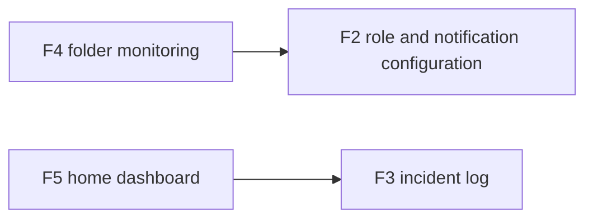

# Features

| ID | Feature | Ticket | Documento |
|---|---|---|---|
| F1 | Member management | — | [member-management.md](member-management.md) |
| F2 | Role and notification-channel configuration | — | [role-notification-configuration.md](role-notification-configuration.md) |
| F3 | Incident log and manual reporting | — | [incident-log.md](incident-log.md) |
| F4 | Watched-image monitoring workflow | — | [folder-monitoring.md](folder-monitoring.md) |
| F5 | Home dashboard | — | [home-dashboard.md](home-dashboard.md) |

## Puntos de entrada → features

| Punto de entrada | Tipo | Código | Feature(s) |
|---|---|---|---|
| `/members`, `/members/{id}` | HTTP | `src/Enrollment.Web/Components/Pages/Members.razor:1`, `MemberDetail.razor:1` | F1 |
| `/api/members/{id}/images/{imageId}` | HTTP | `src/Enrollment.Web/MemberImageEndpoints.cs:22` | F1 |
| `/roles` | HTTP | `src/Enrollment.Web/Components/Pages/Roles.razor:1` | F2 |
| `/incidents` | HTTP | `src/Enrollment.Web/Components/Pages/Incidents.razor:1` | F3 |
| Watcher hospedado | Job | `src/Monitoring.Infrastructure/MonitoringHostedService.cs:26-30` | F4 |
| `/` | HTTP | `src/Enrollment.Web/Components/Pages/Home.razor:1` | F5 |

## Features → puntos de salida

| Feature | Almacenes y efectos principales |
|---|---|
| F1 | Member directory; member image repository; respuesta HTTP |
| F2 | Role repository; notification settings repository |
| F3 | Incident repository |
| F4 | Archiva procesados; cuarentena en error; notificaciones |
| F5 | Lee incidentes recientes |

## Relaciones

## Capacidades asociadas y specs heredadas

Estas capacidades ya están implementadas, pero se mantienen como documentos auxiliares asociados a las features principales:

| Capacidad | Feature principal | Documento | Spec |
|---|---|---|---|
| Access decision policy | F4 | [access-decision-policy.md](access-decision-policy.md) | [spec](../../openspec/specs/access-decision-policy/spec.md) |
| Access notification | F4 / F2 | [access-notification.md](access-notification.md) | [spec](../../openspec/specs/access-notification/spec.md) |
| Enrollment watch ingestion | F1 (capacidad separada) | [enrollment-watch-ingestion.md](enrollment-watch-ingestion.md) | [spec](../../openspec/specs/enrollment-watch-ingestion/spec.md) |
| Identity verification | F4 / F1 | [identity-verification.md](identity-verification.md) | [spec](../../openspec/specs/identity-verification/spec.md) |
| Member directory query | F1 / F4 | [member-directory-query.md](member-directory-query.md) | [spec](../../openspec/specs/member-directory-query/spec.md) |
| Member enrollment | F1 | [member-enrollment.md](member-enrollment.md) | [spec](../../openspec/specs/member-enrollment/spec.md) |
| Motion image ingestion | F4 | [motion-image-ingestion.md](motion-image-ingestion.md) | [spec](../../openspec/specs/motion-image-ingestion/spec.md) |
| Pending verification record | F4 | [pending-verification-record.md](pending-verification-record.md) | [spec](../../openspec/specs/pending-verification-record/spec.md) |
| Person detection | F4 | [person-detection.md](person-detection.md) | [spec](../../openspec/specs/person-detection/spec.md) |
