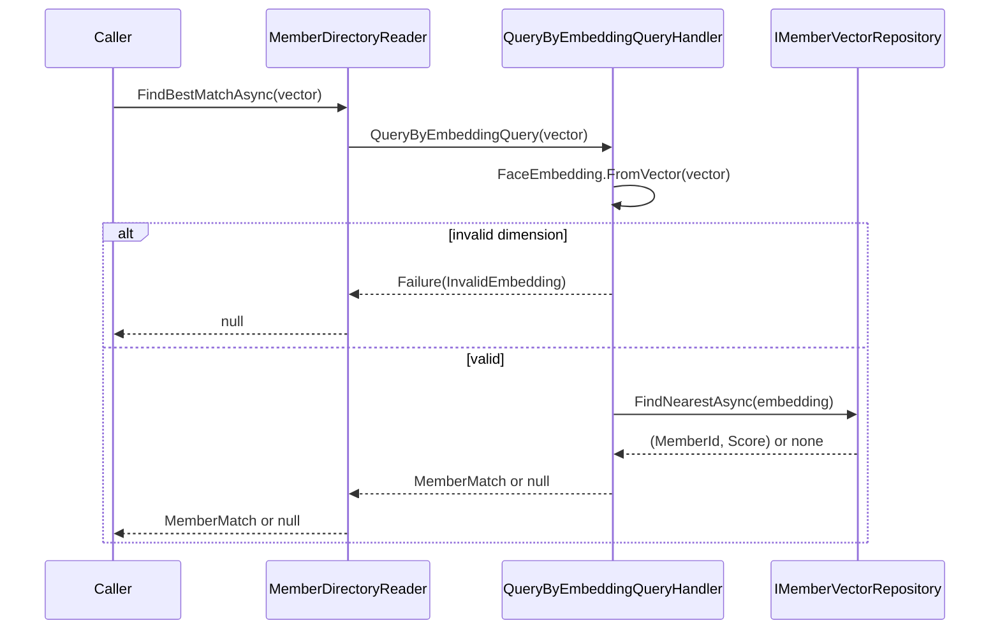

# Design: AI-Managed Access Control — Phase 1 (Scaffolding + Enrollment)

## Technical Approach

Modular monolith, single `.slnx`, CPM via `Directory.Packages.props`, all new projects target **net10.0** (`Directory.Build.props`: `Nullable`, `ImplicitUsings`, `EnablePreviewFeatures`), SDK pinned via `global.json` (`10.0.103`, `rollForward: latestFeature`) — mirrors the reference course repo. `Enrollment` owns Domain/Application/Infrastructure/PublicApi; `Common` holds only cross-cutting technical config (vector-store options, OpenTelemetry wiring), never business models. Face embeddings are local ONNX (FaceAiSharp/ArcFace) behind `IFaceEmbeddingExtractor`; identity matching is deterministic vector similarity, never LLM-arbitrated, per the proposal's security-auditability rationale (Azure Face rejected: identify/verify are Limited Access, gated to customers with a direct Microsoft account-team relationship — not a "wait for approval" case).

## Solution Layout

| Project | TFM | Role |
|---|---|---|
| `src/Enrollment.Domain` | net10.0 | `Member` aggregate, `FaceEmbedding`/`MemberId` VOs, `IMemberVectorRepository` port |
| `src/Enrollment.Application` | net10.0 | `RegisterMemberCommand`/Handler, `QueryByEmbeddingQuery`/Handler, `IFaceEmbeddingExtractor` port |
| `src/Enrollment.Infrastructure` | net10.0 | `FaceAiSharpEmbeddingExtractor`, `SqliteVecMemberRepository`, `AddEnrollment(...)` DI extension |
| `src/Enrollment.PublicApi` | net10.0 | `IMemberDirectoryReader` + boundary DTOs (`MemberMatch`) — the only surface Monitoring may reference later |
| `src/Common` | net10.0 | `VectorStoreOptions`, OpenTelemetry `ActivitySource` registration extension |
| `src/Enrollment.Console` | net10.0 | Standalone FaceAiSharp net10 spike — no reference to `Enrollment.*` |
| `tests/Enrollment.UnitTests` | net10.0 | AutoMocker-based handler/domain tests + spike characterization test |
| `Directory.Packages.props`, `Directory.Build.props`, `global.json`, `CamGuard.slnx` | — | CPM, net10.0/preview features, SDK 10.0.103 pin |

## Architecture Decisions

| Decision | Choice | Alternatives considered | Rationale |
|---|---|---|---|
| Embedding source | FaceAiSharp/ArcFace ONNX, local | Azure Face API; LLM `RunAsync<T>()` | Azure identify/verify is Limited Access gated to Microsoft-managed accounts (confirmed, research Lane 1) — not obtainable; LLM output is non-deterministic/unauditable for a security decision |
| Vector store | `CommunityToolkit.VectorData.SqliteVec` 1.0.1-preview | `Microsoft.SemanticKernel.Connectors.SqliteVec` (superseded name) | Current MS docs point to `CommunityToolkit.VectorData.*` as maintained pattern (research Lane 3); preview risk mitigated by isolating behind `IMemberVectorRepository` |
| Domain entity persistence mapping | Separate Infrastructure-only vector-store record (`[VectorStoreKey]`/`[VectorStoreData]`/`[VectorStoreVector]`), mapped from `Member` by an Infrastructure mapper | Put vector-store attributes directly on `Member` per `entity-model`'s default `[Table]/[Column]` guidance | That skill's attributes target a SQL-builder pattern, not a vector store; keeping attributes off Domain preserves `dotnet-clean-architecture`'s "Domain independent of Infrastructure" |
| `Member` base class | `EntityBase<MemberId>` (domain events) | Plain `Entity<TId>` | `Member` raises `MemberEnrolled`, translated to an integration event for `monitoring-pipeline` later per `dotnet-modular-monolith` |
| Public contract shape | `IMemberDirectoryReader` takes/returns primitive `float[]`/`MemberMatch` DTO, never the internal `FaceEmbedding` VO | Expose `FaceEmbedding` directly | Boundary DTOs only, per `dotnet-modular-monolith` — internal VOs never cross module boundaries |
| Spike harness | `Enrollment.Console` calls FaceAiSharp directly, zero reference to `Enrollment.*` | Build `Enrollment.Infrastructure` first, test net10 compat through it | Proposal requires the spike pass **before** Infrastructure depends on FaceAiSharp; a dependent harness would hide a failure inside the adapter |
| Multi-photo submission vs. single-embedding `Member` | `RegisterMemberCommand` accepts `IReadOnlyList<Stream> Photos` (non-empty); the handler extracts and gates every photo independently, and only when ALL pass does it call `Member.Enroll` with the **first** photo's embedding as the primary embedding, then persist once | Model `Member` with multiple `FaceEmbedding`s (one per photo) | `member-enrollment` spec's "Atomic Vector Persistence" requirement only mandates all-or-nothing persistence across submitted photos — it does not specify combining multiple embeddings into one record. Keeps `Member`'s existing "exactly one `FaceEmbedding`" invariant unchanged, per PR4 verify-remediation scope |

## Domain Model

- `MemberId` (sealed record, wraps `Guid`) — non-empty (`Guid.Empty` rejected).
- `FaceEmbedding` (sealed record, `IReadOnlyList<float> Vector`) — factory `FromVector(float[])` validates: length == `ExpectedDimension` (assumed **512**, ArcFace/LResNet100E-IR convention — **unconfirmed against FaceAiSharp's actual bundled model output; verify in the spike and adjust the constant if wrong**); vector not all-zero.
- `Member` : `EntityBase<MemberId>`, sealed — invariants: `FullName` non-empty/whitespace, exactly one `FaceEmbedding`. Factory `Member.Enroll(MemberId, string fullName, FaceEmbedding)` returns `Result<Member, MemberError>`, raises `MemberEnrolled`.

## Ports and Adapters

```csharp
// Enrollment.Application
public interface IFaceEmbeddingExtractor
{
    Task<Result<FaceEmbedding, FaceExtractionError>> ExtractAsync(Stream photo, CancellationToken ct);
}
public enum FaceExtractionError { NoFaceDetected, MultipleFacesDetected, ExtractionFailed }

// Enrollment.Domain
public interface IMemberVectorRepository
{
    Task SaveAsync(Member member, CancellationToken ct);
    Task<(MemberId Id, double Score)?> FindNearestAsync(FaceEmbedding query, CancellationToken ct);
}

// Enrollment.PublicApi
public interface IMemberDirectoryReader
{
    Task<MemberMatch?> FindBestMatchAsync(float[] embeddingVector, CancellationToken ct);
}
public sealed record MemberMatch(Guid MemberId, double Score);
```

`FaceAiSharpEmbeddingExtractor` wraps SCRFD detection (reject 0 or 2+ faces) + ArcFace embedding. `SqliteVecMemberRepository` wraps `CommunityToolkit.VectorData.SqliteVec` — the only class referencing that preview package, per the proposal's rollback plan.

## Application Flow

```mermaid
sequenceDiagram
    participant Client
    participant Handler as RegisterMemberCommandHandler
    participant Extractor as IFaceEmbeddingExtractor
    participant Member as Member (Domain)
    participant Repo as IMemberVectorRepository
    Client->>Handler: RegisterMemberCommand(fullName, photos[1..N])
    loop for each submitted photo, in order
        Handler->>Extractor: ExtractAsync(photo)
        alt zero or multiple faces
            Extractor-->>Handler: Failure(NoFaceDetected|MultipleFacesDetected)
            Handler-->>Client: Result.Failure(error)
            Note over Handler,Repo: Atomic gate — the first failing photo rejects the whole<br/>enrollment; remaining photos are never processed and<br/>SaveAsync is never called, so nothing is persisted.
        else exactly one face
            Extractor-->>Handler: Success(FaceEmbedding)
        end
    end
    Note over Handler: Reached only when every submitted photo passed the gate.
    Handler->>Member: Member.Enroll(id, fullName, embeddings[0])
    Member-->>Handler: Success(member) + MemberEnrolled
    Handler->>Repo: SaveAsync(member)
    Handler-->>Client: Result.Success(MemberId)
```



## DI / Composition Root

```csharp
public static IServiceCollection AddEnrollment(this IServiceCollection services, IConfiguration configuration)
{
    // Closes over the `configuration` parameter directly — `.Configure<IConfiguration>((o, c) => ...)`
    // (the form originally sketched here) resolves IConfiguration *from the container*, which
    // only works inside a full host (e.g. ASP.NET Core) that auto-registers it. PR 3's DI
    // integration test caught this failing against a bare ServiceCollection; fixed as shown.
    services.AddOptions<VectorStoreOptions>()
        .Configure(o => configuration.GetSection(VectorStoreOptions.SectionName).Bind(o));

    services.AddNamedObservabilitySource(EnrollmentServiceCollectionExtensions.ActivitySourceName); // "CamGuard.Enrollment"

    // FaceAiSharp's detector/generator wrap loaded ONNX models — singletons, built only via the
    // documented factory (never resolved via service locator inside a collaborator).
    services.TryAddSingleton<IFaceDetectorWithLandmarks>(_ => FaceAiSharpBundleFactory.CreateFaceDetectorWithLandmarks());
    services.TryAddSingleton<IFaceEmbeddingsGenerator>(_ => FaceAiSharpBundleFactory.CreateFaceEmbeddingsGenerator());

    services.TryAddScoped<IFaceEmbeddingExtractor, FaceAiSharpEmbeddingExtractor>();
    services.TryAddScoped<IMemberVectorRepository, SqliteVecMemberRepository>();
    services.TryAddScoped<RegisterMemberCommandHandler>();
    services.TryAddScoped<QueryByEmbeddingQueryHandler>();
    services.TryAddScoped<IMemberDirectoryReader, MemberDirectoryReader>();
    return services;
}
```

Single call site (future `Program.cs`); one extension per `dotnet-composition-root`. Verified end-to-end by `EnrollmentServiceCollectionExtensionsTests` (PR 3) — resolves `IMemberDirectoryReader`, `RegisterMemberCommandHandler`, and `QueryByEmbeddingQueryHandler` from a real `ServiceProvider` with `validateScopes: true`, against a temp SQLite connection string.

## Observability

`Common.ObservabilityServiceCollectionExtensions.AddNamedObservabilitySource(string sourceName)` registers a keyed `ActivitySource`/`Meter` pair (`TryAddKeyedSingleton`, keyed by `sourceName`) so multiple modules can each open their own named source without colliding on the shared service types; `Enrollment.Infrastructure` calls it with `"CamGuard.Enrollment"` (`EnrollmentServiceCollectionExtensions.ActivitySourceName`) from `AddEnrollment(...)`. `FaceAiSharpEmbeddingExtractor`/`SqliteVecMemberRepository` consume it via `[FromKeyedServices(...)]` constructor injection (never a static field, per `dotnet-testable-code-design`). Spans: `Enrollment.ExtractEmbedding` (tags: `faces.detected.count`, `outcome`) around `IFaceEmbeddingExtractor`; `Enrollment.VectorStore.Save` and `Enrollment.VectorStore.Query` (tags: `match.score`, `latency`) around `IMemberVectorRepository`. This establishes the span-naming/tagging convention `monitoring-pipeline` extends for detect/identify/decide/notify.

## Testing Strategy

| Layer | What to Test | Approach |
|---|---|---|
| Domain | `Member.Enroll` invariants, `FaceEmbedding.FromVector` dimension/zero-vector checks | Pure unit tests, no mocks |
| Application | `RegisterMemberCommandHandler` (reject 0/2+ faces, happy path), `QueryByEmbeddingQueryHandler` | `AutoMocker` fakes `IFaceEmbeddingExtractor`/`IMemberVectorRepository` |
| Spike/characterization | "FaceAiSharp runs on net10" | `Enrollment.Console`'s injectable `FaceAiSharpSpike.Run(imagePath)` class (never inline in `Main`, per `dotnet-testable-code-design`), exercised by a thin `Main` AND a `FaceAiSharpNet10CompatibilityTests` test asserting no exception + returned vector length == expected dimension |
| Infrastructure | `SqliteVecMemberRepository` round-trip | Integration test against a temp SQLite file, not mocked |

## Threat Matrix

N/A — no routing, shell, subprocess, VCS/PR automation, executable-file classification, or process-integration boundary in Phase 1 (`FileSystemWatcher`/pipeline integration is `monitoring-pipeline`, deferred).

## Migration / Rollout

Greenfield: no data migration. Sequencing is load-bearing: (1) scaffolding files, (2) `Enrollment.Console` spike must pass, (3) Domain/Application (no FaceAiSharp/SqliteVec dependency), (4) Infrastructure adapters, (5) PublicApi wiring. Rollback: delete `Enrollment.*`/`Common`/scaffolding — nothing else references them yet.

## Open Questions

- [x] **Net10.0 runtime compatibility (PR 1 spike, tasks 2.1–2.6) — CONFIRMED, with one finding.** FaceAiSharp 0.6.35 (`ScrfdDetector` via `FaceAiSharpBundleFactory.CreateFaceDetectorWithLandmarks()`, `ArcFaceEmbeddingsGenerator` via `CreateFaceEmbeddingsGenerator()`) constructs and runs on net10.0 (SDK 10.0.100) without exception — **but only once the native ONNX Runtime binaries are referenced explicitly**. `FaceAiSharp`/`FaceAiSharp.Bundle` depend only on `Microsoft.ML.OnnxRuntime.Managed` (the managed P/Invoke bindings); they do **not** pull in a native runtime package. Without it, `FaceAiSharpBundleFactory.CreateFaceDetectorWithLandmarks()` crashes the test host with a native access violation (`0xC0000005` in `Microsoft.ML.OnnxRuntime.CompileApi.NativeMethods..ctor`) — not a managed exception, a process crash. Fix: add `Microsoft.ML.OnnxRuntime` (CPU native package, pinned to the same `1.26.0` FaceAiSharp 0.6.35 depends on for `.Managed`) as an explicit `PackageReference` in any project that constructs a FaceAiSharp detector/generator (currently `Enrollment.Console`; `Enrollment.Infrastructure` will need it too in Phase 4). Recorded so Phase 4 does not rediscover this the hard way.
- [ ] **ArcFace embedding dimensionality — STILL UNCONFIRMED, assumed 512.** No real photo of a human face was available in the PR 1 environment/session. The automated `FaceAiSharpNet10CompatibilityTests` only proves runtime/package compatibility against a synthetic faceless placeholder image (`src/Enrollment.Console/testdata/blank-image.png`) — it asserts construction succeeds and that a faceless image correctly returns zero detected faces without crashing. It does **not** exercise the embedding path (that requires exactly one detected face). **Required manual follow-up before Phase 4 (`FaceEmbedding.ExpectedDimension`) trusts the 512 assumption**: run `dotnet run --project src/Enrollment.Console -- <path-to-a-real-reference-photo>` locally, confirm `Outcome: Success`, and record the printed `Embedding dimension:` value here, replacing this line with the confirmed number.
- [x] **Distance/similarity metric — RESOLVED in PR 3.** `MemberVectorRecord.Embedding` (the Infrastructure-only vector-store record, `SqliteVecMemberRepository.cs`) is attributed `[VectorStoreVector(FaceEmbedding.ExpectedDimension, DistanceFunction = DistanceFunction.CosineDistance)]`: cosine distance (0 = identical, 2 = opposite), the standard comparison convention for ArcFace-family embeddings. `FindNearestAsync`'s `Score` is therefore a cosine-distance value (lower is more similar), passed through from `VectorSearchResult<TRecord>.Score` unchanged — `monitoring-pipeline` must interpret it accordingly (not as a 0–1 similarity score).
- [x] Confirm FaceAiSharp's detector API exposes a direct face count vs. requiring manual enumeration of detection results — **CONFIRMED**: `IFaceDetector.DetectFaces(Image<Rgb24>)` returns `IReadOnlyCollection<FaceDetectorResult>`, so `.Count` gives the face count directly; no manual enumeration needed for the zero/one/multiple-face gate.
