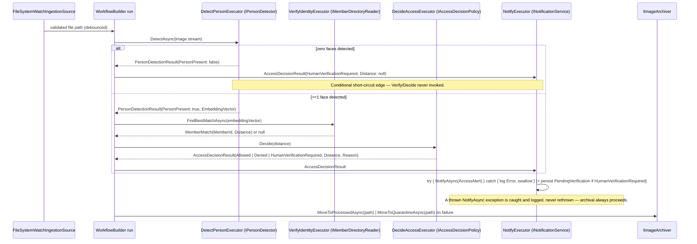

# Design: Monitoring Pipeline (Detect → Verify → Decide → Notify)

## Technical Approach

Add a third modular-monolith module, `Monitoring`, following `ai-access-control`'s exact layering (`Domain`/`Application`/`Infrastructure`, no `PublicApi` needed yet — nothing downstream consumes Monitoring). Monitoring project-references only `Enrollment.PublicApi.IMemberDirectoryReader`, never Enrollment's internal projects (`dotnet-modular-monolith`: "immediate answer required → PublicApi + boundary DTOs"). The pipeline is expressed as a `Microsoft.Agents.AI.Workflows` `WorkflowBuilder` graph (detect → verify → decide → notify), triggered once per file by a channel-debounced `FileSystemWatcher`, with `HumanVerificationRequired` as a terminal outcome, never a suspended workflow. All naming preserves `Distance` (cosine distance, lower = closer) end to end, per the resolved Enrollment open question.

## Solution Layout

| Project | TFM | CPM | Role |
|---|---|---|---|
| `src/Monitoring.Domain` | net10.0 | `Directory.Packages.props` (existing, no new package versions needed — adds a direct `PackageReference` to the already-centrally-pinned `CSharpFunctionalExtensions`, same version `Enrollment.Domain` uses) | `AccessOutcome`, `AccessDecisionResult`, `PendingVerification`, `PendingVerificationId`, `PendingVerificationStatus` |
| `src/Monitoring.Application` | net10.0 | same | Ports (`IPersonDetector`, `IAccessDecisionPolicy`, `INotificationService`, `IImageArchiver`, `IIngestionSource`), workflow executors, `AccessAlert` DTO |
| `src/Monitoring.Infrastructure` | net10.0 | same, adds `Microsoft.Agents.AI.Workflows` (already a standing project package, first *used* here) | `LoggingNotificationService`, `FaceAiSharpPersonDetector` (channel-serialized), `FileSystemImageArchiver`, `FileSystemWatchIngestionSource`, `AccessDecisionPolicy`, `AddMonitoring(...)` |
| `tests/Monitoring.UnitTests` | net10.0 | same | AutoMocker unit tests + folder-watch integration-style harness |

No new project needs a new `Directory.Packages.props` entry beyond `Microsoft.Agents.AI.Workflows`'s version, already pinned centrally per `ai-access-control` precedent; `Directory.Build.props`/`global.json` (net10.0, SDK 10.0.103) are inherited unchanged.

## Domain Model (`Monitoring.Domain`)

```csharp
public enum AccessOutcome { Allowed, Denied, HumanVerificationRequired }

public sealed record AccessDecisionResult(AccessOutcome Outcome, double Distance, string Reason);

public enum PendingVerificationStatus { Pending }

public sealed record PendingVerificationId : IComparable<PendingVerificationId>
{
    private PendingVerificationId(Guid value) => Value = value;
    public Guid Value { get; }
    public int CompareTo(PendingVerificationId? other) => other is null ? 1 : Value.CompareTo(other.Value);
    public static PendingVerificationId New() => new(Guid.NewGuid());
    public override string ToString() => Value.ToString();
}

public sealed class PendingVerification : Entity<PendingVerificationId>
{
    public string ImageReference { get; }
    public double? Distance { get; }              // null when zero faces detected
    public Guid? CandidateMemberId { get; }
    public DateTimeOffset OccurredAtUtc { get; }   // via injected TimeProvider, never DateTime.UtcNow
    public PendingVerificationStatus Status { get; private set; } = PendingVerificationStatus.Pending;

    public static PendingVerification Create(
        PendingVerificationId id, string imageReference, double? distance,
        Guid? candidateMemberId, DateTimeOffset occurredAtUtc) => new(...);
}
```

`AccessDecisionResult` is a plain `sealed record` (value-object skill: no identity, immutable, validated at construction). `PendingVerificationId` mirrors `Enrollment.Domain.MemberId`'s exact pattern (`sealed record : IComparable<TSelf>`, private constructor, `New()` factory) — a local value-typed identity owned entirely by `Monitoring.Domain`, per the `value-object` skill. `PendingVerification` extends `CSharpFunctionalExtensions.Entity<PendingVerificationId>` **directly**, not `Enrollment.Domain.EntityBase<TId>`: `EntityBase<TId>` lives in `src/Enrollment.Domain`, an internal Enrollment project that `Monitoring.*` is never allowed to reference (proposal Success Criteria; this design's own module-boundary rule) — only referencing it would require a forbidden `Monitoring.Domain` → `Enrollment.Domain` project reference. `CSharpFunctionalExtensions` itself is a plain NuGet package, already centrally pinned in `Directory.Packages.props` for `Enrollment.Domain`'s own use, so `Monitoring.Domain` adding its own direct `PackageReference` to it introduces no new module coupling. Per the `entity-model` skill's decision gate ("entity with no domain events or audit → `Entity<TId>` directly"), `PendingVerification` raises no domain events in this change — the resolve/close write path is explicitly out of scope — so the plain Khorikov base is sufficient; a shared cross-module base relocated into `src/Common` would be unwarranted ceremony for one entity type in one module.

## Ports and Adapters (`Monitoring.Application` ports / `Monitoring.Infrastructure` adapters)

```csharp
// Monitoring.Application
public interface IPersonDetector
{
    Task<PersonDetectionResult> DetectAsync(Stream image, CancellationToken ct);
}
public sealed record PersonDetectionResult(bool PersonPresent, float[]? EmbeddingVector);

// Scoping note: PersonDetectionResult models exactly one embedding per image — this design
// deliberately scopes to single-person-per-image access control (the primary/first detected
// face only); multiple simultaneous faces in one frame is out of scope for this change, not
// an oversight, and is left for a future change to model as EmbeddingVector[] if ever needed.

public interface IAccessDecisionPolicy
{
    AccessDecisionResult Decide(double distance);
}

public interface INotificationService
{
    Task NotifyAsync(AccessAlert alert, CancellationToken ct);
}
public sealed record AccessAlert(
    Guid? MemberId, double? Distance, AccessOutcome Outcome,
    string ImageReference, DateTimeOffset OccurredAtUtc, string? Reason);

public interface IImageArchiver
{
    Task<string> MoveToProcessedAsync(string sourcePath, CancellationToken ct);
    Task<string> MoveToQuarantineAsync(string sourcePath, CancellationToken ct);
}

public interface IIngestionSource
{
    IAsyncEnumerable<string> WatchAsync(CancellationToken ct); // yields validated, debounced file paths
}
```

`Monitoring.Infrastructure` implements each: `FaceAiSharpPersonDetector` (wraps SCRFD detection + embedding extraction, channel-serialized — see Concurrency Design), `AccessDecisionPolicy` (single deterministic class, `AccessDecisionOptions`-driven, no Strategy pattern per exploration's decision gate — no repeated-branch growth exists), `LoggingNotificationService` (`ILogger`-based), `FileSystemImageArchiver` (moves to `processed/`/`quarantine/`), `FileSystemWatchIngestionSource` (`FileSystemWatcher.Created` → bounded `Channel<string>` → debounce-retry consumer, per `ai-access-control` research reuse).

## Application Flow

**Workflow graph shape** (`Microsoft.Agents.AI.Workflows.WorkflowBuilder`):

- Executors: `DetectPersonExecutor` → `VerifyIdentityExecutor` → `DecideAccessExecutor` → `NotifyExecutor`.
- Edges: `DetectPersonExecutor` has a **conditional short-circuit edge** straight to `NotifyExecutor` when `PersonDetectionResult.PersonPresent == false` (zero faces detected), carrying a synthesized `AccessDecisionResult(HumanVerificationRequired, Distance: null, "No face detected")` — bypassing `VerifyIdentityExecutor`/`DecideAccessExecutor` entirely. The normal edge (`PersonPresent == true`) proceeds to `VerifyIdentityExecutor` → `DecideAccessExecutor`, whose output is a 3-way `AccessDecisionResult` (`Allowed`/`Denied`/`HumanVerificationRequired` on distance-in-gray-zone) feeding the same `NotifyExecutor`. `NotifyExecutor` additionally persists a `PendingVerification` (via a repository port, `Monitoring.Infrastructure`-owned in-memory/file-backed store — out of scope to specify further per proposal) whenever outcome is `HumanVerificationRequired`. `NotifyExecutor` wraps the `INotificationService.NotifyAsync` call in a try/catch: any exception thrown by `NotifyAsync` (or `LoggingNotificationService`) MUST be caught and logged at `Error` level via the injected `ILogger`, then swallowed — never rethrown — so a notifier failure can neither crash the workflow run nor block the subsequent `IImageArchiver` step (`access-notification` spec's Notification Failure Isolation requirement). The run always proceeds to archival (`processed/` or `quarantine/`) regardless of notify outcome.



## Concurrency Design

**Choice**: a bounded single-consumer `Channel<PersonDetectionRequest>` inside `FaceAiSharpPersonDetector` (Infrastructure), not a raw `SemaphoreSlim` scattered across call sites.

| Option | Tradeoff |
|---|---|
| `SemaphoreSlim(1,1)` around each `Detect`/embed call site | Correct, but the lock is a cross-cutting concern callers must remember to acquire at every call site; easy to bypass by accident in a future adapter |
| Single-consumer `Channel<T>` inside the adapter | The serialization point is *structural*, not a discipline the caller must remember — `FaceAiSharpPersonDetector.DetectAsync` enqueues a request+`TaskCompletionSource`, one background loop drains the channel and calls the ONNX detector/embedder, satisfying the TCS. Callers get an ordinary `async` method; concurrency is invisible and impossible to bypass. |

**Rationale (research.md)**: FaceAiSharp/OnnxRuntime CPU `Run()` concurrency is medium-confidence safe (maintainer Discussions, not official docs), with one contradicting third-party source. The proposal's conservative fallback is adopted regardless of confidence level. The channel approach keeps the guard entirely inside `Monitoring.Infrastructure` — never Domain/Application, which stay unaware that a single shared detector exists at all.

## DI / Composition Root

```csharp
public static IServiceCollection AddMonitoring(this IServiceCollection services, IConfiguration configuration)
{
    ArgumentNullException.ThrowIfNull(configuration);

    // Mirrors AddEnrollment(...) exactly: closes over `configuration` directly, never
    // `.Configure<IConfiguration>((o, c) => ...)` resolved from the container.
    services.AddOptions<AccessDecisionOptions>()
        .Configure(o => configuration.GetSection(AccessDecisionOptions.SectionName).Bind(o))
        .Validate(o => o.AllowedMaxDistance < o.DeniedMinDistance,
            "AllowedMaxDistance must be less than DeniedMinDistance.");
    services.AddOptions<WatchFolderOptions>()
        .Configure(o => configuration.GetSection(WatchFolderOptions.SectionName).Bind(o));

    services.AddNamedObservabilitySource(MonitoringServiceCollectionExtensions.ActivitySourceName); // "CamGuard.Monitoring"

    services.TryAddSingleton<IPersonDetector, FaceAiSharpPersonDetector>(); // owns the channel/consumer loop
    services.TryAddScoped<IAccessDecisionPolicy, AccessDecisionPolicy>();
    services.TryAddScoped<INotificationService, LoggingNotificationService>();
    services.TryAddScoped<IImageArchiver, FileSystemImageArchiver>();
    services.TryAddSingleton<IIngestionSource, FileSystemWatchIngestionSource>();
    services.TryAddSingleton<MonitoringWorkflowHost>(); // builds/hosts the WorkflowBuilder graph

    return services;
}
```

Host composes both: `services.AddEnrollment(configuration).AddMonitoring(configuration);` — a single process, two independent composition roots, neither referencing the other's internals.

## Observability

Reuses `Common.AddNamedObservabilitySource("CamGuard.Monitoring")` exactly as `Enrollment` does, injected via `[FromKeyedServices("CamGuard.Monitoring")]` (never a static field). Spans, one per pipeline stage:

| Span | Tags |
|---|---|
| `Monitoring.Ingest` | `file.path` (archived-safe reference, not raw path if sensitive), `debounce.attempts` |
| `Monitoring.DetectPerson` | `faces.detected.count`, `person.present` |
| `Monitoring.VerifyIdentity` | `match.found` (bool) |
| `Monitoring.Decide` | `outcome` (`AccessOutcome`), `distance` |
| `Monitoring.Notify` | `outcome`, `notification.channel` (`"logging"`) |

## Testability

| Dependency | Faked with |
|---|---|
| `IPersonDetector` | `AutoMocker`-generated mock; unit tests never touch FaceAiSharp/ONNX |
| `IAccessDecisionPolicy` | Real `AccessDecisionPolicy` gets pure unit tests (deterministic thresholds, no mock needed); consumers mock the interface |
| `INotificationService` | `AutoMocker`-generated mock; assert `NotifyAsync` called once with expected `AccessAlert`; a second test substitutes a mock configured to `ThrowAsync` on `NotifyAsync` and asserts `NotifyExecutor` still completes, the exception is logged (via a fake/captured `ILogger`), and archival (`IImageArchiver.MoveToProcessedAsync`) is still invoked — proving Notification Failure Isolation |
| `IImageArchiver` | `AutoMocker`-generated mock for workflow-executor unit tests |
| `IMemberDirectoryReader` (existing) | `AutoMocker`-generated mock (Monitoring never constructs the real `Enrollment.Infrastructure` type) |

**Folder-watch → workflow → decision integration-style test harness (structural, not full code)**:
1. Arrange: `Directory.CreateTempSubdirectory()` as the watch root; build a real `FileSystemWatchIngestionSource` + `MonitoringWorkflowHost` via `ServiceProvider` (`AddMonitoring` with mocked `IPersonDetector`/`IMemberDirectoryReader` substituted post-registration, real `FileSystemImageArchiver`/`FileSystemWatchIngestionSource`).
2. Act: copy a fixture image into the temp watch folder; await (with timeout) until the file is moved out of the watch root (to `processed/` or `quarantine/`).
3. Assert: file landed in the expected subfolder; mocked `INotificationService.NotifyAsync` was invoked once with the expected `AccessOutcome`.

## Threat Matrix

N/A — no routing, shell command execution, subprocess invocation, VCS/PR automation, executable-file classification, or process-integration boundary. `FileSystemWatcher`/file-move are local filesystem I/O against a single configured drop folder, not user-supplied paths or commands.

## Migration / Rollout

No migration required (additive-only). Rollout order: (1) `Monitoring.Domain` (no dependencies), (2) `Monitoring.Application` (ports + workflow executors, references `Enrollment.PublicApi` only for `IMemberDirectoryReader`), (3) `Monitoring.Infrastructure` (adapters + `AddMonitoring`), (4) host wiring (`AddEnrollment(...).AddMonitoring(...)`). Rollback: remove the `AddMonitoring(...)` call and delete `src/Monitoring.*`.

## Open Questions

- [ ] Exact persistence for `PendingVerification` (in-memory vs. file-backed vs. future SQLite table) is unspecified by the proposal — `sdd-tasks` should default to an in-memory/file-backed store scoped to Monitoring, upgradeable later without touching Domain.
- [ ] Gray-zone `HumanVerificationRequired` threshold band (distance between `AllowedMaxDistance` and `DeniedMinDistance`) needs default values in `AccessDecisionOptions` — deferred to task-level implementation, not a design blocker.
- [ ] No `BackgroundService`/`IHostedService` wires `IIngestionSource.WatchAsync` → `MonitoringWorkflowHost` → `IImageArchiver` together in a real running process; today only `MonitoringWorkflowIntegrationTests` exercises that wiring. A production hosting entrypoint is deferred to a follow-up change.
